  

  
  
  

  
  

 

<!-- ABOUT -->

  

 

<!-- TOOLBOX -->

  

 

<!-- FEATURED PROJECTS -->

  
  

  

 

<!-- GITHUB STATS -->

  

<!-- CONTRIBUTION SNAKE -->

  <picture>
    <source
      media="(prefers-color-scheme: dark)"
      srcset="https://raw.githubusercontent.com/Chera-Wondimu/Chera-Wondimu/output/snake-dark.svg"
    />
    
  </picture>

<!-- FOOTER -->

  

