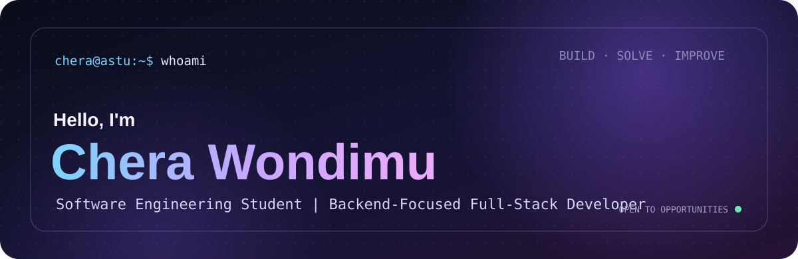
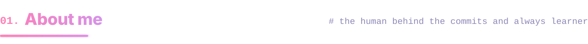
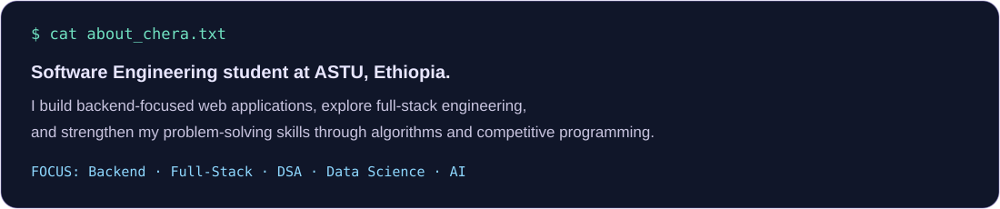
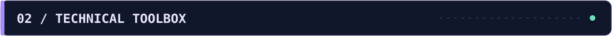
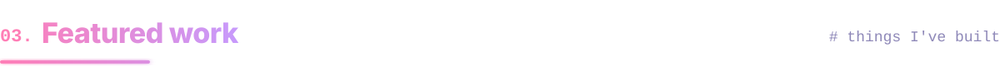
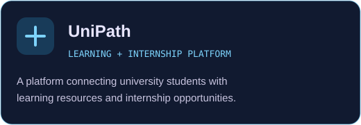
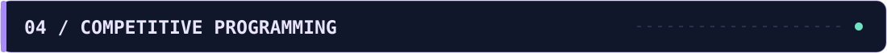
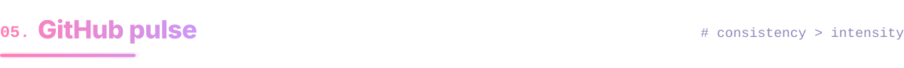

  

  
  
  

  
  

 

  

 

  

 

  
  

  

 

  

 

  

  <picture>
    <source media="(prefers-color-scheme: dark)" srcset="https://raw.githubusercontent.com/Chera-Wondimu/Chera-Wondimu/output/snake-dark.svg"/>
    
  </picture>

  

